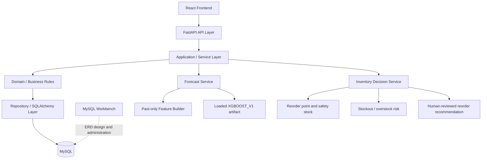

# Architecture

## High-level Architecture

```text
React + Vite Frontend
      ↓
FastAPI Backend
      ↓
SQLAlchemy
      ↓
MySQL
      ↑
MySQL Workbench (ERD design and database administration)
```

## Business Pipeline

```text
Sales History
      ↓
Preprocessing
      ↓
Time-Series Feature Engineering
      ↓
Forecast Model
      ↓
Predicted Demand
      ↓
Current Inventory + Supplier Lead Time + Safety Stock + Incoming Stock
      ↓
Stockout / Overstock Analysis
      ↓
Reorder Recommendation
```

## Scope Boundaries

This is a single-store MVP for a small/medium supermarket, not a full ERP. Planned forecasting must influence actual inventory recommendations; it is not an isolated analytics feature. Full POS, payment, accounting, loyalty, delivery logistics, native mobile, full multi-branch support, barcode scanning, and advanced deep learning remain out of scope unless explicitly approved.

## Database Technology Decision

**MySQL 8.x** is the implemented relational database engine. FastAPI accesses the local MySQL Server through SQLAlchemy 2.x and the PyMySQL driver; Alembic revision `f86d36b27719` owns the initial schema. **MySQL Workbench is not the database**: it is the GUI/tool for ERD design, schema inspection, SQL execution, and database administration. It is not an application runtime dependency.

## Sales Data Ingestion Architecture

### Initial Historical Import

```text
Existing supermarket POS historical export
      ↓
CSV import process
      ↓
Smart Inventory Market
      ↓
sales_daily
```

An initial CSV import gives a newly adopting supermarket enough history for forecasting.

### Ongoing Sales Sync

```text
POS / external sales system
      ↓
API or database integration
      ↓
Smart Inventory Market
      ↓
sales_daily
```

The thesis MVP needs CSV sales import and a clearly defined future POS/API integration boundary; it does not need to implement a complete POS. In model development/evaluation, M5 supplies historical sales. In a real deployment, the system must eventually use that supermarket's own POS sales, not Walmart M5 data.

## Layered Backend Design — CHECKPOINT-011



P13+ must preserve these boundaries: FastAPI routes coordinate requests and responses but must not contain all business rules. Forecasting and inventory decision logic are separate services, while repositories isolate persistence concerns. The system is decision support: recommendation generation ends in human manager review and must not automatically purchase from suppliers.

## Current Implementation Status

P17 implements the React/Vite presentation layer, and P18 added cookie-session authentication and UI refinement. Browser routes use a shared fetch/error client and React Query cache invalidation to call the thin FastAPI routes already owned by service/repository layers. Vite proxies `/api` and `/health` to the local backend; `VITE_API_BASE_URL` supports a future non-secret deployment origin. The frontend visualizes existing persisted forecast and decision data but does not reproduce ML or inventory formulas in the browser. P24-06 adds a protected `/account` route backed by narrow self-service auth endpoints: a user may update only their display name, manage one verified raster avatar stored outside Git, and change their password. The password-change transaction preserves the current validated session and revokes the user's other active sessions; role, activation state, password hash, and filesystem path remain server-owned. P20 audited the functional boundary; its unresolved workflow findings are deliberately planned work, not claims of completed behavior.

## P22 M5-grounded supermarket simulation architecture (PLANNED)

P22 is a thesis demonstration data architecture, not a claim that M5 contains operational inventory. It keeps two provenance domains separate:

```text
Observed M5 CA_1/FOODS data
  sales history + calendar/events + sell prices
      + traceable product-to-M5-SKU mapping
      ↓
Frozen XGBOOST_V1 eligible forecast

Synthetic operational scenario (separately marked)
  inventory + suppliers + supplier-product mappings + purchase orders
      ↓
Inventory decision and manager-reviewed recommendation
```

- **Observed domain:** P22 may import only the frozen M5 historical sales, calendar/event context, and historical prices needed by an eligible CA_1/FOODS SKU. The imported product record must retain a durable mapping to its exact M5 item/store/SKU identity and scenario manifest entry.
- **Synthetic domain:** on-hand inventory, suppliers, lead times, supplier mappings, and purchase orders are simulation inputs. They must be visibly and persistently scenario-marked, must never be described as observed Walmart inventory, and must support a marker/manifest-scoped dry run and safe reset.
- **Forecast boundary:** the frozen XGBOOST_V1 artifact is usable only for mapped, eligible M5 SKU identities with the required historical context. The application must not imply or attempt forecasting for an arbitrary newly created SKU.
- **Future POS boundary:** the `sales_daily` CSV/import and API integration boundary remains compatible with real POS ingestion. A different supermarket must map its own product catalog and retrain/evaluate a new model on its own POS, product, calendar, and price context before operational forecasting.
- **Version boundary:** P22 does not modify, retrain, reselect, or reinterpret original XGBOOST_V1 validation or TEST results. Any later research is versioned separately as P23 XGBoost V2.

P21 is complete before P22: it implemented the P20 business-integrity fixes—server-derived audit attribution, a guarded accepted-recommendation-to-linked-draft-PO workflow with duplicate prevention, idempotent operational sales, partial-receipt/cancellation/draft-editing PO controls, forecast eligibility feedback, and query-error recovery. P24 then performs end-to-end testing and evaluation with regression, live-environment, browser, and inventory evidence; no phase may use the original held-out XGBOOST_V1 TEST window for later tuning.
